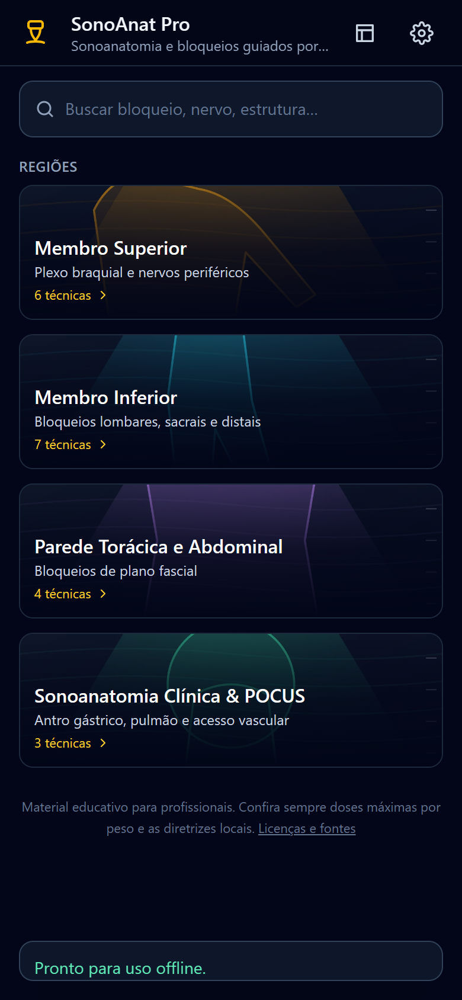
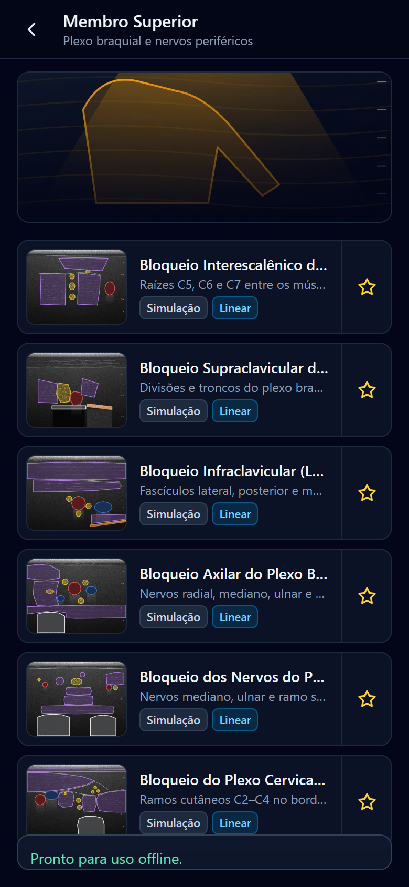
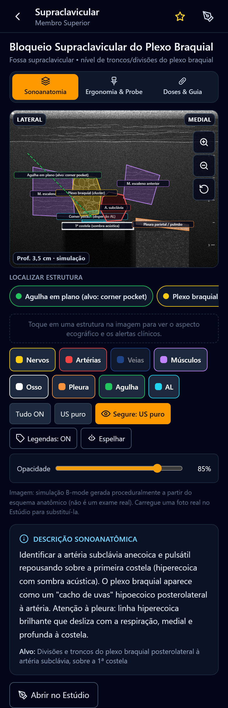

# SonoAnat Pro

Atlas de sonoanatomia e bloqueios de nervos guiados por ultrassom para anestesiologia. PWA mobile-first, 100% offline, inspirado na organização do app AnSo.

O app fica em [`sonoanat-pro/`](sonoanat-pro/). A versão antiga em HTML puro está em [`legacy/`](legacy/) apenas como referência.

## Rodar localmente

```bash
cd sonoanat-pro
npm install
npm run dev        # desenvolvimento em http://localhost:5173
npm run build      # gera dist/ com service worker e manifest
npm run preview    # serve o build em http://localhost:4173
npm test           # testes (vitest)
```

## O que tem

- 20 técnicas em 4 regiões: membro superior, membro inferior, parede torácica/abdominal e POCUS.
- Visualizador 4:3 com imagem de ultrassom e overlays SVG por camada (nervos, artérias, veias, músculos, osso, pleura, agulha, dispersão do anestésico), zoom até 350%, espelhar, "Segure: US puro", legendas ON/OFF e opacidade.
- "Localizar estrutura": toque num chip e a estrutura é destacada na imagem; toque na imagem e o rodapé mostra aspecto ecográfico e alertas.
- 3 abas por bloqueio: Sonoanatomia, Ergonomia & Probe, Doses & Guia Clínico (indicações, doses, pérolas, referências com DOI).
- Estúdio de anotação: carregue sua própria foto de ultrassom, desenhe polígonos/agulha, posicione legendas, salve no aparelho (IndexedDB).
- Modo B: par de imagens (US puro + anotada) com slider.
- Backup/importação em `.json`, favoritos, instalação como app (PWA).
- Quando um bloqueio não tem foto real, o app gera uma simulação B-mode determinística (speckle, sombra acústica, vasos anecoicos, régua de profundidade).

## Telas

| Início | Região | Bloqueio |
|---|---|---|
|  |  |  |

## Imagens reais

`sonoanat-pro/tools/fetch_ultrasound_images.py` busca figuras de ultrassom com licença CC BY em artigos de acesso aberto (Europe PMC / PubMed Central). Cada imagem usada traz atribuição no app e em `sonoanat-pro/public/images/real/ATTRIBUTION.md`.

## Aviso

Material educativo para profissionais de saúde. Não substitui treinamento supervisionado nem o julgamento clínico. Confira doses máximas por peso e as diretrizes locais.
