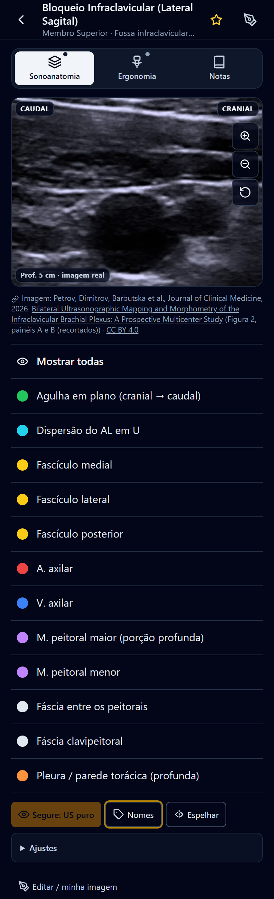
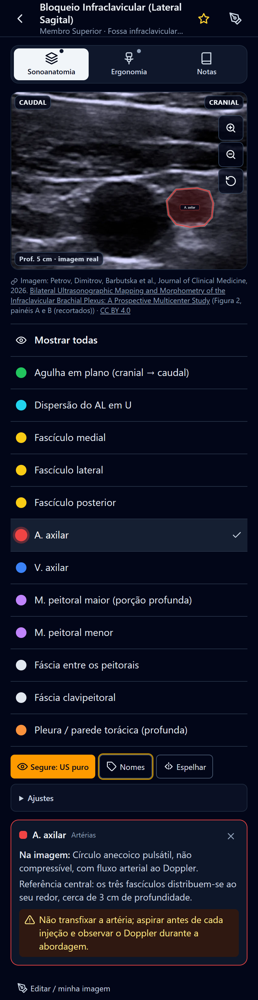
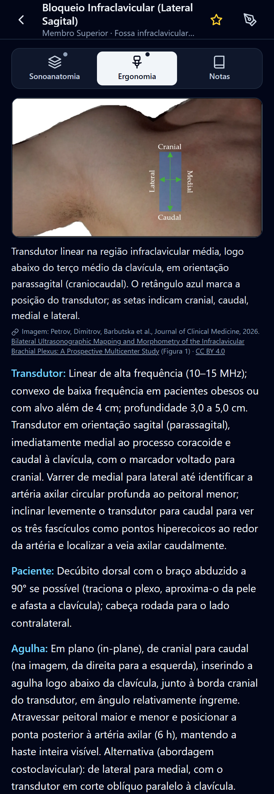
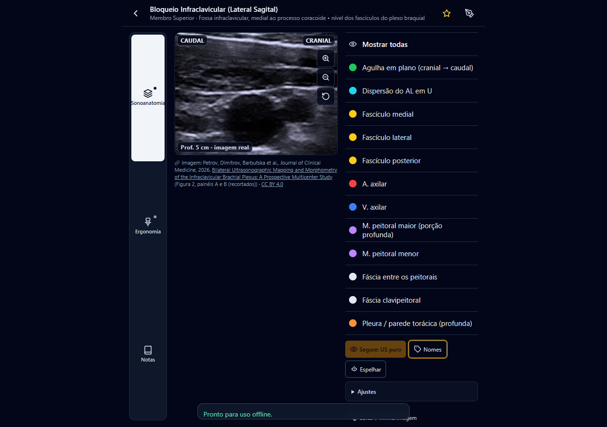

# SonoAnat Pro

Atlas de sonoanatomia e bloqueios de nervos guiados por ultrassom para anestesiologia. PWA mobile-first, 100% offline, inspirado na organização do app AnSo.

O app fica em [`sonoanat-pro/`](sonoanat-pro/). A versão antiga em HTML puro está em [`legacy/`](legacy/) apenas como referência.

## Rodar localmente

```bash
cd sonoanat-pro
npm install
npm run dev        # desenvolvimento em http://localhost:5173
npm run build      # gera dist/ com service worker e manifest
npm run preview    # serve o build em http://localhost:4173
npm test           # testes (vitest)
```

## O que tem

- 20 técnicas em 4 regiões: membro superior, membro inferior, parede torácica/abdominal e POCUS.
- Cada bloqueio tem três vistas, como no AnSo: **Sonoanatomia** (imagem real de ultrassom, limpa), **Ergonomia** (fotos reais da posição do paciente e do transdutor) e **Notas** (indicações, posicionamento, transdutor, agulha, doses, pérolas, referências com DOI).
- Na sonoanatomia, a lista de estruturas fica abaixo da imagem: toque numa estrutura e ela aparece colorida sobre a imagem; toque de novo e some. "Mostrar todas", "Segure: US puro", nomes na imagem, espelhar, zoom até 350%.
- Imagens reais de artigos de acesso aberto (licença CC BY), com a fonte citada em cada imagem. Alguns bloqueios têm par pré/pós-injeção (controle "Imagem anotada pelos autores").
- Estúdio de anotação: carregue sua própria foto de ultrassom, desenhe polígonos/agulha, posicione legendas, salve no aparelho (IndexedDB).
- Backup/importação em `.json`, favoritos, instalação como app (PWA offline).

## Telas

| Imagem limpa | Estrutura ligada | Ergonomia |
|---|---|---|
|  |  |  |

No computador a lista fica à direita da imagem: 

## Imagens reais

`sonoanat-pro/tools/fetch_ultrasound_images.py` busca figuras com licença CC BY em artigos de acesso aberto (Europe PMC / PubMed Central); `tools/crop-frac.mjs` recorta os painéis. Cada imagem usada traz atribuição no app, na tela Licenças e em `sonoanat-pro/public/images/real/ATTRIBUTION.md`. Nenhuma imagem do app AnSo ou de outros apps comerciais é usada.

## Aviso

Material educativo para profissionais de saúde. Não substitui treinamento supervisionado nem o julgamento clínico. Confira doses máximas por peso e as diretrizes locais.
